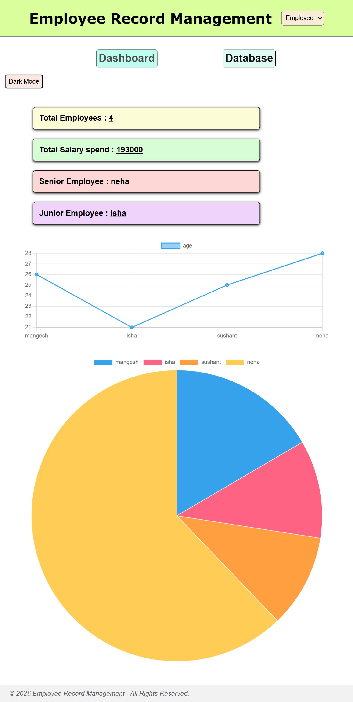
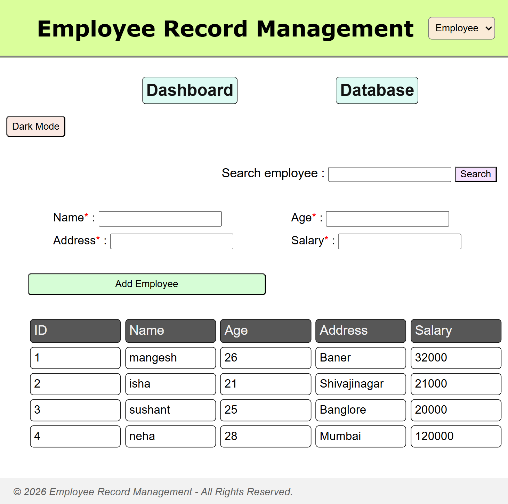
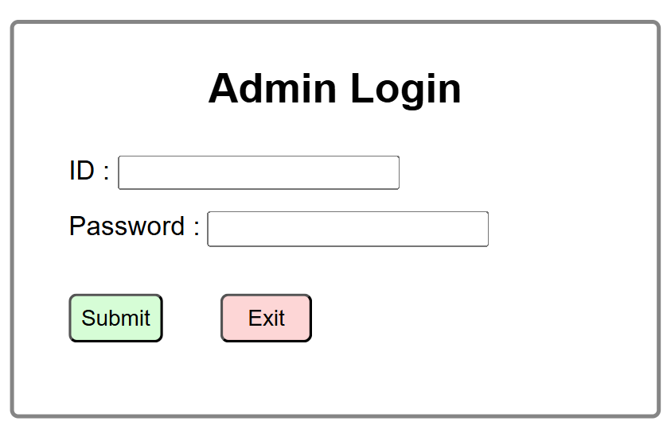
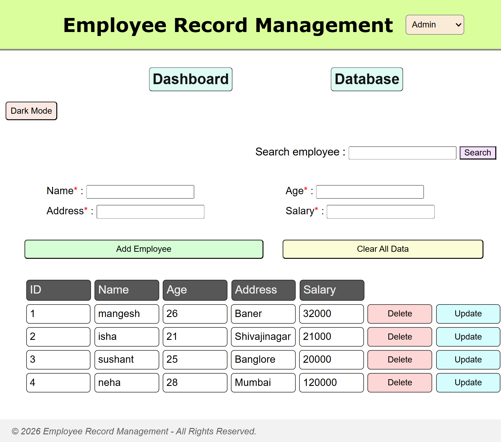

# Employee Record Management System

A frontend-based Employee Record Management System built using HTML, CSS and JavaScript. This project provides an interactive interface to manage employee records, view employee statistics and visualise employee data.

---

## 🚀 Features

- Add new employee records
- View employee details in a structured database
- Update and delete employee records
- Search employees by name
- Store employee data using browser LocalStorage
- Dashboard displaying employee statistics
- Visual representation of employee age and salary using Chart.js
- Admin and Employee interfaces
- Dark and Light mode toggle
- Responsive user interface for different screen sizes

---

## 🛠️ Technologies Used

- HTML5
- CSS3 (Flexbox, Grid & Media Queries)
- JavaScript (DOM Manipulation & Event Handling)
- Chart.js (Data Visualization)
- Browser LocalStorage (Data Persistence)

---

## 📂 Project Structure

```
Employee-Record-Management-System/
├── index.html
├── css/
│   └── style.css
├── js/
│   └── main.js
├── screenshots/
│   ├── Dashboard_preview.png
│   ├── Employee_database_preview.png
│   ├── Login_page.png
│   └── Admin_database_preview.png
│
├── README.md
├── LICENSE                → (MIT)
└── .gitignore             → (Node)
```
---

## 🖼️ Preview

- Dashboard preview



- Employee database preview



- Login page



- Admin database preview



---

## 📌 Purpose of the Project

This project was built to:

- Practice JavaScript fundamentals and DOM manipulation
- Understand CRUD operations in frontend applications
- Learn browser-based data storage using LocalStorage
- Implement interactive dashboards and data visualisation
- Improve responsive web design skills

---

## 👤 Author

*Lokesh Sapkal*  
Software Developer | MCA Graduate

---

## 📄 License

This project is licensed under the *MIT License*.
